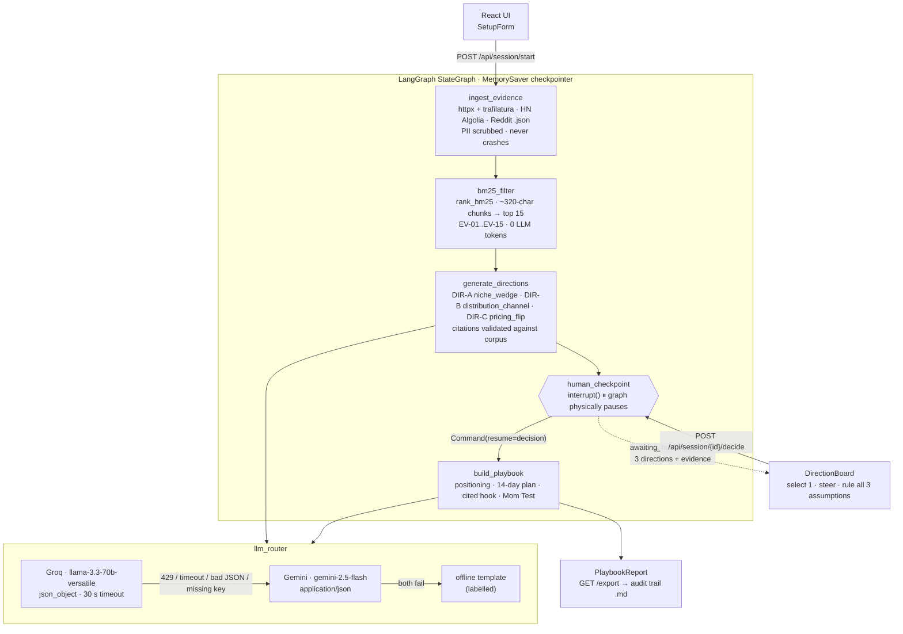

# Wedge: Evidence-Backed Direction Engine for Founders

> Built for the **AI Agents for Founders Challenge, HETIC 2026**.

Founders don't need an AI telling them to abandon their idea. They need to know **which angle wins**.
Wedge keeps your core idea fixed and scrapes live, GDPR-safe public market evidence. It then proposes **3 cited
strategic directions**: a niche wedge, a distribution channel and a pricing flip. After that it **hard-pauses** at a mandatory
Human Judgment Checkpoint. There you pick one direction, steer it, and rule on every assumption it rests on. Only then
does Wedge write a focused 14-day playbook and a Mom Test interview script.

---

## Run it locally (2 commands)

Prerequisites: Python 3.11+, Node 18+. One-time setup:

```bash
cd backend && python -m venv .venv && .venv/Scripts/pip install -r requirements.txt   # macOS/Linux: .venv/bin/pip
cp .env.example .env        # add your free GROQ_API_KEY and GEMINI_API_KEY
cd ../frontend && npm install
```

Then, in two terminals:

```bash
# 1 · backend  (from wedge/backend, venv activated)
uvicorn app.main:app --reload

# 2 · frontend (from wedge/frontend)
npm run dev
```

Open <http://localhost:5173> and click **Demo 1: CampusATS**.

* Free keys: Groq at <https://console.groq.com/keys>, Gemini at <https://aistudio.google.com/apikey>.
* **No keys?** The full flow still runs. Directions and playbook then come from a deterministic **offline template**, which is
  clearly labelled in the UI, the header pill and the export, so no one mistakes it for AI analysis.
* The Vite dev server proxies `/api` to `127.0.0.1:8000`. To use another backend, set `VITE_API_URL`.

---

## Architecture



### Endpoints

| Method | Path | Purpose |
|---|---|---|
| GET | `/api/health` | `{"status":"ok"}` |
| GET | `/api/demos` | CampusATS and InvoicePulse one-click demos |
| POST | `/api/session/start` | Runs the graph until `interrupt()` and returns evidence, directions, metrics and logs |
| POST | `/api/session/{thread_id}/decide` | Validates the direction plus a ruling on **every** assumption, resumes with `Command(resume=…)` and returns the playbook |
| GET | `/api/session/{thread_id}/export` | Downloadable Markdown audit trail |

### Guardrails

* **€0.00 runtime.** Free-tier Groq is primary and Gemini is the automatic fallback. Every node accumulates `prompt_tokens`,
  `completion_tokens`, `total_calls`, `provider_used` and `fallback_triggered`, and the header shows them live.
* **GDPR-safe.** Wedge reads only public competitor pages, Hacker News comment text and public Reddit post text. Usernames are
  never stored. Emails, phone numbers and @/u/ handles are scrubbed. LinkedIn and other social-profile hosts are blocked.
* **Zero uncited directions.** The router post-validates every `evidence_id` against the BM25 corpus. A direction with no
  valid citation is rejected and the request moves to the next provider.
* **Un-skippable checkpoint.** `interrupt()` and `MemorySaver` stop execution server-side. The API returns 422 unless all 3
  assumptions of the selected direction are ruled on, and 409 if the session was already decided.
* **Honest demo cache.** If live scraping yields fewer than 5 chunks (Reddit often returns 403 to bots), Wedge merges cached
  items tagged `demo_cache`. These are **paraphrased summaries** that link to the real public page or search URL, and the UI
  and export say so. Live items are verbatim extracts.

### Project layout

```text
backend/app/  main.py · schemas.py · llm_router.py · scraper.py · frugality.py · demos.py · graph.py
frontend/src/ App.tsx · api.ts · types.ts · components/{HeaderMetrics,SetupForm,DirectionBoard,EvidenceDrawer,PlaybookReport}.tsx
```

---

## AI Disclosure Statement (ready to paste)

| Item | Disclosure |
|---|---|
| AI models used at runtime | Groq `llama-3.3-70b-versatile` (primary) and Google `gemini-2.5-flash` (automatic fallback), both on free tiers |
| Runtime cost | €0.00 |
| Where AI is used | Two LangGraph nodes only: `generate_directions` (3 cited directions) and `build_playbook` (positioning, 14-day plan, landing hook, Mom Test questions) |
| Where AI is **not** used | Scraping, PII scrubbing, BM25 relevance filtering (local `rank_bm25`, 0 tokens), citation validation, checkpoint enforcement, export |
| Token frugality | BM25 sends only the top 15 ~320-char chunks to the LLM. The share of tokens saved is shown live and recorded in the export |
| Usage transparency | Provider, model, prompt/completion tokens, call count and fallback status are tracked per session and shown in the UI and audit trail |
| Human oversight | Mandatory. The graph pauses at `interrupt()` until the founder selects a direction, optionally steers it and rules on every assumption (`confident` / `accept_risk` / `unverified`). Unverified assumptions drive the Mom Test script |
| Data sources | Public competitor pages, Hacker News Algolia API and public Reddit JSON only. No PII, no personal profiles, no LinkedIn |
| Hallucination controls | Strict Pydantic v2 schemas, JSON-mode outputs, evidence-ID validation against the corpus, provider fallback on invalid output |
| Fallback without AI | If no provider is reachable, a deterministic template is used and labelled `offline-template` everywhere |
| AI-assisted development | This codebase was generated with the help of an AI coding assistant (Claude Code) and reviewed and run by the team |
| Launch video | Animated in code (Remotion). The narration is a synthetic voice (Kokoro-82M TTS, run locally); the music is an original score synthesized in code |
